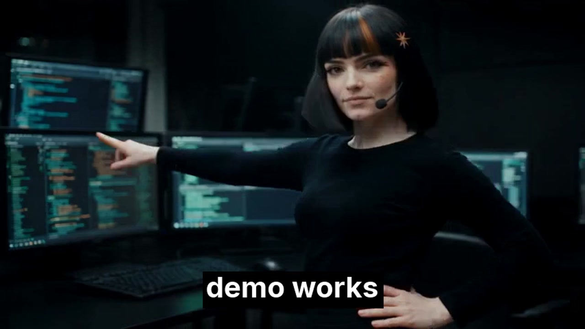
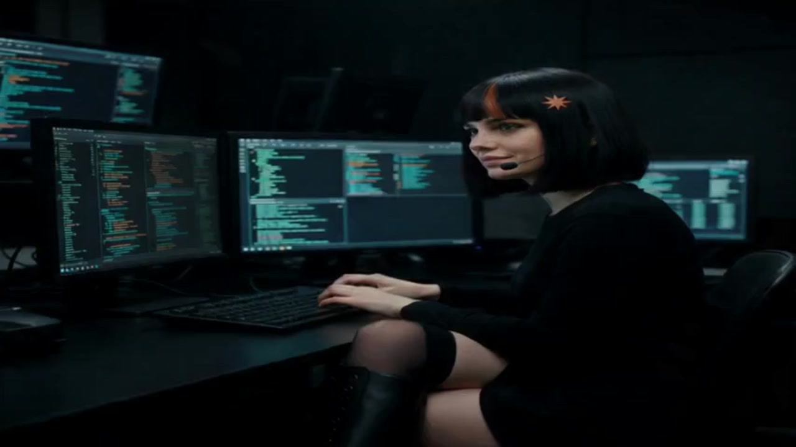
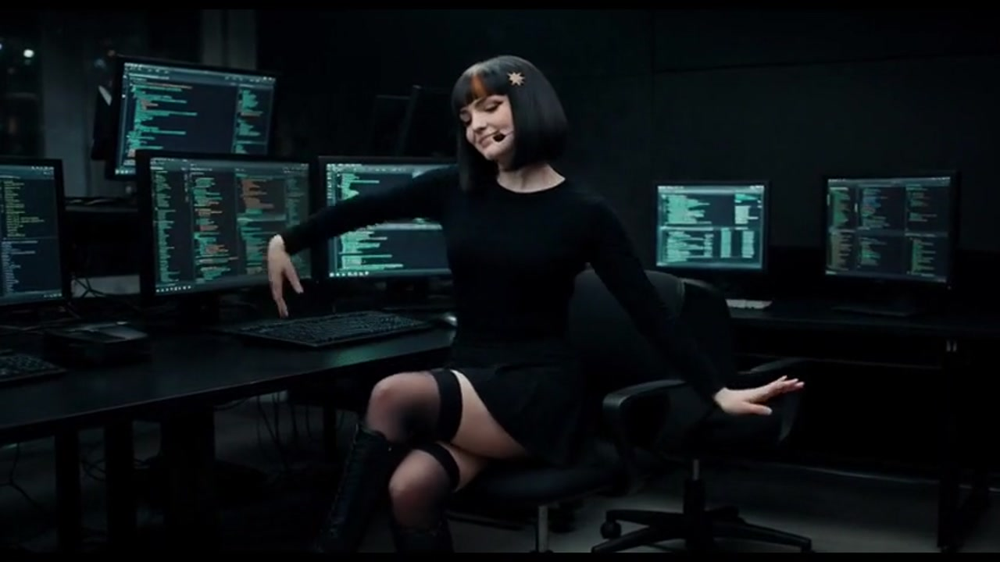
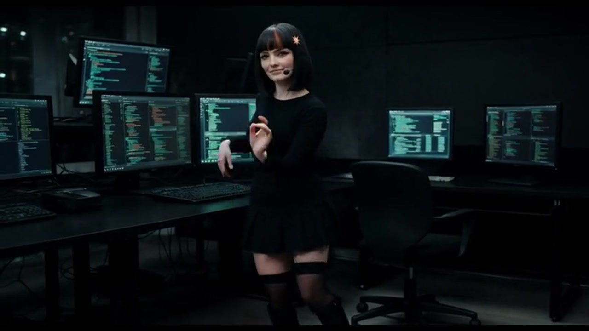

# slopcore

A workspace for AI-generated music videos in the SLOPCORE style, inspired by [@anabology](https://x.com/anabology) and the character Claudia.

The spark was [this post](https://x.com/anabology/status/2108031642640216535): Claudia's soul, downloadable, with the pieces for making A-tier slopcore gathered in one place — an MCP server, an agent skill, a wiki, and character sheets. The invitation at the end was to go make your own.

This repo is that attempt. It started the morning of October 10, 2026, with nothing but a love for the style. The long-term goal is a record of the whole trip from 0 to N: how the idea took shape across iterations, what the tools actually did, and what a finished SLOPCORE music video looks like when the music is original too.

Finished pieces live in `projects/`, one folder each. The next piece gets its own folder and a README. Shared workflow lives in `skills/`.

## Play

Each picture opens the video in a new browser tab. The browser plays it.

<a href="https://hgardneriv-slopcore.vercel.app/projects/whats-a-harness/whats-a-harness-remastered.mp4" target="_blank" rel="noopener">What's a Harness, remastered</a> — 2:37. The approved cut. Claudia, a Suno song, the pointing still, and “demo works” on screen. <a href="https://hgardneriv-slopcore.vercel.app/projects/whats-a-harness/whats-a-harness.wav" target="_blank" rel="noopener">Song wav</a>. [Notes](projects/whats-a-harness/README.md).

<a href="https://hgardneriv-slopcore.vercel.app/projects/whats-a-harness/whats-a-harness.mp4" target="_blank" rel="noopener">What's a Harness</a> — the Higgsfield original. Same song, words on screen.

<a href="https://hgardneriv-slopcore.vercel.app/projects/whats-a-harness/grok-imagine-whats-a-harness.mp4" target="_blank" rel="noopener">What's a Harness, Grok Imagine</a> — 2:37. Pass 1. Same song. She sits and types on the verses, and dances the choruses and drops.

<a href="https://hgardneriv-slopcore.vercel.app/projects/whats-a-harness/grok-imagine-whats-a-harness-1.mp4" target="_blank" rel="noopener">What's a Harness, Grok Imagine, pass 1</a> — the same cut, saved with `-1` in the name.

<a href="https://hgardneriv-slopcore.vercel.app/projects/whats-a-harness/grok-imagine-whats-a-harness-2.mp4" target="_blank" rel="noopener">What's a Harness, Grok Imagine, pass 2</a> — same verses, harder clothed club choreography on the choruses and drops.

<a href="https://hgardneriv-slopcore.vercel.app/projects/swordplay/swordplay-hero-3.mp4" target="_blank" rel="noopener">Sword Play, Full Pass</a> — Grok Imagine sword fight on the guitar riff. [Notes](projects/swordplay/README.md).

<a href="https://hgardneriv-slopcore.vercel.app/projects/swordplay/swordplay-full.mp4" target="_blank" rel="noopener">Sword Play, 2nd pass</a> — Day 1 kept this pass.

<a href="https://hgardneriv-slopcore.vercel.app/projects/swordplay/swordplay.mp4" target="_blank" rel="noopener">Sword Play, First Pass</a> — the first sword fight.

The same files are on one page at [hgardneriv-slopcore.vercel.app](https://hgardneriv-slopcore.vercel.app). Locally, `scripts/serve.sh` serves them at `http://127.0.0.1:47821`.

## Vercel

The player is [hgardneriv-slopcore.vercel.app](https://hgardneriv-slopcore.vercel.app). A clip's address is its path, for example [the harness video](https://hgardneriv-slopcore.vercel.app/projects/whats-a-harness/whats-a-harness.mp4).

Auto-deploy on each push to `main` starts after the [Vercel GitHub app](https://github.com/apps/vercel) is installed on `hgardneriv/slopcore`. The project is `slopcore` under `hgardnerivs-projects`. Framework preset is Other, the build command is empty, and the output is the repo root.

## Goal

Learn how to generate SLOPCORE-style music videos in the vein of anabology's Claudia work, scored with original AI music, and write down the path as it happens.

## Tools

- **Cursor** — the workspace, and the place the iterations happen
- **Grok Imagine** — image and video generation
- **[Suno](https://suno.com/)** — original AI music
- **[Higgsfield](https://open.higgsfield.ai/)** — Seedance video via API

## Skills

[skills/claudia-slopcore/SKILL.md](skills/claudia-slopcore/SKILL.md) is the workflow for the next Claudia piece: lock the wav, approve stills, generate Seedance one section at a time, and remux with [skills/claudia-slopcore/scripts/mux-song.sh](skills/claudia-slopcore/scripts/mux-song.sh). The script needs ffmpeg.

Do not paste API keys into the repo or into chat.

- `XAI_API_KEY` for Grok Imagine
- `higgsfield_api_key` for Seedance on Higgsfield

## Credit

Claudia is an open character by [anabology](https://x.com/anabology) ([claudia.gallery](https://claudia.gallery)). The tweet that inspired this project is [this post](https://x.com/anabology/status/2108031642640216535). Release under your own name. Do not put feat. Claudia in the artist field. Say the work is AI.
