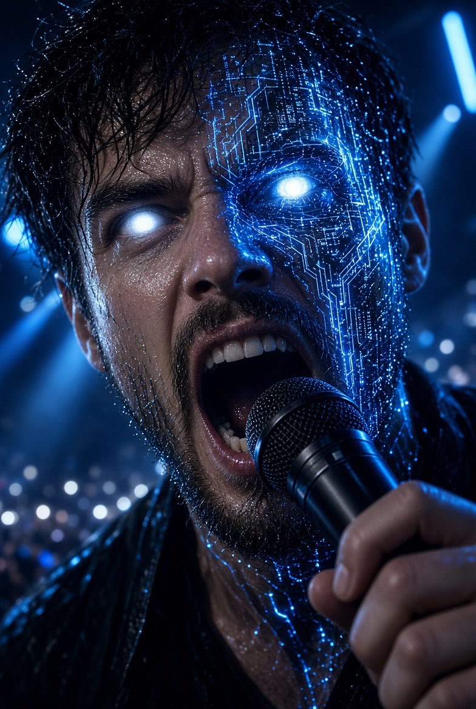

# slopcore

A workspace for AI-generated music videos in the SLOPCORE style. It started the morning of October 10, 2026, with nothing but a love for the style, and the point of the repo is to keep the record: who made what, with which tool, on the way from 0 to N.

## Credit

- **Style** — [@anabology](https://x.com/anabology) and the character Claudia. The spark was [this post](https://x.com/anabology/status/2108031642640216535): Claudia's soul, downloadable, with the pieces for A-tier slopcore gathered in one place — an MCP server, an agent skill, a wiki, and character sheets. The invitation was to go make your own.
- **Lyrics** — written in Cursor with Grok, by boiling down [Paweł Huryn](https://x.com/PawelHuryn)'s post ["What's a harness?"](https://x.com/PawelHuryn/status/2086448359624052862). That post names twelve terms that matter in 2026: agent, reasoning effort, skill, MCP, context engineering, AI evals, vibe coding, agentic engineering, harness, loop engineering, graph engineering, and intent engineering.
- **Music** — [Suno](https://suno.com/). The lyric sheet went in with the settings below.
- **Picture** — Cursor, Grok Imagine, and the [Higgsfield](https://open.higgsfield.ai/) API.

## Play

Each link opens GitHub's player for that file.

### Hello Grok

<a href="https://hgardneriv-slopcore.vercel.app/projects/hello-grok-hardcore/hello-grok-hardcore-full.mp4" target="_blank" rel="noopener">Hello Grok (Hard Core) Video</a>

<a href="https://hgardneriv-slopcore.vercel.app/projects/hello-grok-hardcore/hello-grok-hardcore-full.mp4" target="_blank" rel="noopener">https://hgardneriv-slopcore.vercel.app/projects/hello-grok-hardcore/hello-grok-hardcore-full.mp4</a>

<a href="https://hgardneriv-slopcore.vercel.app/projects/hello-grok/hello-grok.wav" target="_blank" rel="noopener">Hello Grok (Audio)</a>

<a href="https://hgardneriv-slopcore.vercel.app/projects/hello-grok/hello-grok.wav" target="_blank" rel="noopener">https://hgardneriv-slopcore.vercel.app/projects/hello-grok/hello-grok.wav</a>

<a href="https://hgardneriv-slopcore.vercel.app/projects/hello-grok/hello-grok-hardcore.wav" target="_blank" rel="noopener">Hello Grok (Hard Core) Audio</a>

<a href="https://hgardneriv-slopcore.vercel.app/projects/hello-grok/hello-grok-hardcore.wav" target="_blank" rel="noopener">https://hgardneriv-slopcore.vercel.app/projects/hello-grok/hello-grok-hardcore.wav</a>

### What's a Harness

[Play Whats_a_Harness.wav](./Whats_a_Harness.wav)

First original track. About 2:37, stereo, 48 kHz. Lyrics from the Huryn post above. Music from Suno.

Style:

> metallic hardcore, deathstep, 180 BPM, half-time dubstep drums, snare on the backbeat, tight distorted rhythm-guitar chugs, growling wobble bass, aggressive LFO bass drops, punchy dry kick, dark and heavy, breakdown into a bass drop, no lead guitar, deadpan female spoken verses, close and dry, clipped and confident, every word crisp and intelligible, euphoric sung female chorus with big clear vowels, stacked chanted vocals in the drop

Exclude styles: male lead vocal, mumbled vocals, rap, lead guitar solo, shredding, clean pop, lo-fi, future bass, EDM supersaw, trap, acoustic, autotune.

| Setting | Value |
| --- | --- |
| Vocal gender | Female |
| Duration | Auto |
| Max mode | Off |
| Weirdness | 30% |
| Style influence | 75% |
| Variety | Normal |
| Personalize | Off |

### Swordplay

Day 1 clips.

- [Play swordplay.mp4](./swordplay.mp4)
- [Play swordplay-full.mp4](./swordplay-full.mp4)
- [Play swordplay-hero-3.mp4](./swordplay-hero-3.mp4)

Each link opens GitHub's player for that file.

### What's a Harness

[Play Whats_a_Harness.wav](./Whats_a_Harness.wav)

First original track. About 2:37, stereo, 48 kHz. Lyrics from the Huryn post above. Music from Suno.

Style:

> metallic hardcore, deathstep, 180 BPM, half-time dubstep drums, snare on the backbeat, tight distorted rhythm-guitar chugs, growling wobble bass, aggressive LFO bass drops, punchy dry kick, dark and heavy, breakdown into a bass drop, no lead guitar, deadpan female spoken verses, close and dry, clipped and confident, every word crisp and intelligible, euphoric sung female chorus with big clear vowels, stacked chanted vocals in the drop

Exclude styles: male lead vocal, mumbled vocals, rap, lead guitar solo, shredding, clean pop, lo-fi, future bass, EDM supersaw, trap, acoustic, autotune.

| Setting | Value |
| --- | --- |
| Vocal gender | Female |
| Duration | Auto |
| Max mode | Off |
| Weirdness | 30% |
| Style influence | 75% |
| Variety | Normal |
| Personalize | Off |

### Swordplay

Day 1 clips.

- [Play swordplay.mp4](./swordplay.mp4)
- [Play swordplay-full.mp4](./swordplay-full.mp4)
- [Play swordplay-hero-3.mp4](./swordplay-hero-3.mp4)

A character and a real cut are still ahead. After day 1, the possibilities already feel wide open. Stay tuned.

## Tools

- **Cursor** — the workspace, and the place the iterations happen
- **Grok Imagine** — image and video generation
- **[Suno](https://suno.com/)** — original AI music
- **[Higgsfield](https://open.higgsfield.ai/)** — Seedance video via API

## Skills

[skills/claudia-slopcore/SKILL.md](skills/claudia-slopcore/SKILL.md) is the workflow for the next Claudia piece: lock the wav, approve stills, generate Seedance one section at a time, and remux with [skills/claudia-slopcore/scripts/mux-song.sh](skills/claudia-slopcore/scripts/mux-song.sh). The script needs ffmpeg.

Do not paste API keys into the repo or into chat.

- `XAI_API_KEY` for Grok Imagine
- `higgsfield_api_key` for Seedance on Higgsfield

## Credit

Claudia is an open character by [anabology](https://x.com/anabology) ([claudia.gallery](https://claudia.gallery)). The tweet that inspired this project is [this post](https://x.com/anabology/status/2108031642640216535). Release under your own name. Do not put feat. Claudia in the artist field. Say the work is AI.
