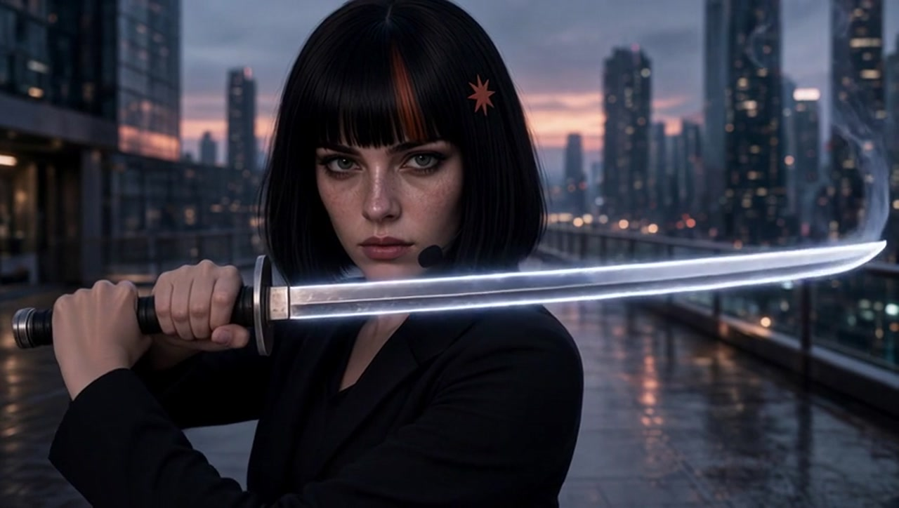
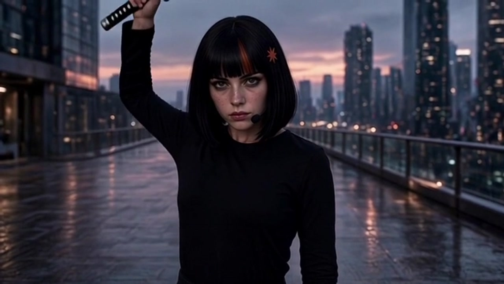
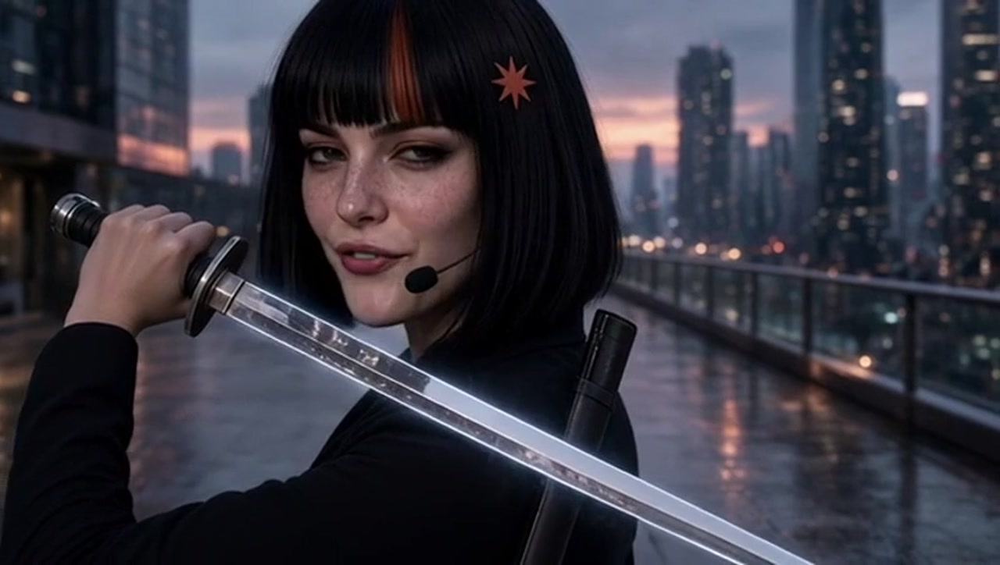

# Swordplay

Short Grok Imagine sword-fight pictures cut to the guitar riff. The riff is in these clips. This is the earlier picture, before What's a Harness. The rooftop sword fight stayed out of that song.

<a href="https://hgardneriv-slopcore.vercel.app/projects/swordplay/swordplay.mp4" target="_blank" rel="noopener">Sword Play, First Pass</a>

<a href="https://hgardneriv-slopcore.vercel.app/projects/swordplay/swordplay-full.mp4" target="_blank" rel="noopener">Sword Play, 2nd pass</a>

<a href="https://hgardneriv-slopcore.vercel.app/projects/swordplay/swordplay-hero-3.mp4" target="_blank" rel="noopener">Sword Play, Full Pass</a>

## Stack

- The guitar riff Harry already had. It was not sent back through a music model.
- Grok Imagine video, for the moving shots. The key is `XAI_API_KEY`.
- ffmpeg, to mux the riff so the clip plays.

## Credit

Where Claudia is in the frame, she is an open character by [anabology](https://x.com/anabology) ([claudia.gallery](https://claudia.gallery)). The tweet that inspired this project is [this post](https://x.com/anabology/status/2108031642640216535). Say the work is AI.

## Cost

No xAI invoice was saved for these takes. The list price we wrote down for `grok-imagine-video-1.5` was $0.08 a second at 480p, plus $0.01 when an image was an input. That is a rate card, not a bill. ffmpeg is free.
